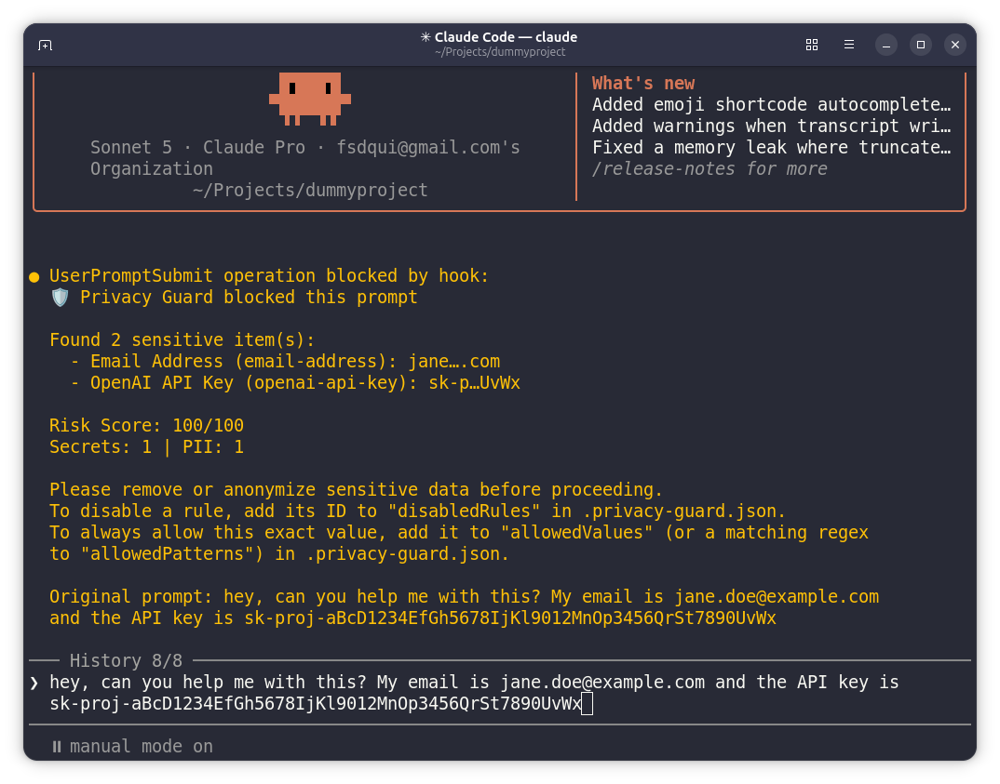

# Claude Code Privacy Guard


> 🛡️ Stops Claude Code from reading your secrets, not just from you typing them.

A privacy-first plugin for Claude Code. Coding agents don't only see what you type: they read files and run commands on their own, and one `cat .env` puts your credentials in the model's context. Privacy Guard checks every path a secret can take - your prompts, the agent's tool calls, the files it reads, and the output it gets back - and **blocks** the leak before it reaches the AI. It keeps protecting in auto mode, where nobody is approving tool calls.



## Features

- ✅ **Blocks prompts** containing secrets or PII before they're sent to Claude
- ✅ **Guards tool calls** - stops Claude from reading `.env`, SSH keys, cloud credential files, or any file whose contents hold a secret, and from dumping the environment through Bash
- ✅ **Works in auto mode** - where a confirmation prompt would never reach you, it denies instead of asking
- ✅ **Warns after the fact** - if a secret shows up in tool output, you're told so you can rotate it, and Claude is told not to repeat it
- ✅ **Broad detection** - about 200 rules from gitleaks plus code-focused checks (`.env` lines, high-entropy tokens), and opt-in card, SSN and phone detection
- ✅ **Works locally** - no network calls, no telemetry; adds roughly 20 ms per check
- ✅ **Zero configuration** - works out of the box, and documentation addresses like `user@example.com` are never flagged
- ✅ **Toggle rules and manage allowlists** - by hand in `.privacy-guard.json`, or via `npx claude-code-privacy-guard rules` for a local web UI

## Installation

```bash
# Add the marketplace (if not already added)
/plugin marketplace add datumbrain/claude-code-privacy-guard

# Install the plugin
/plugin install claude-code-privacy-guard
```

> **⚠️ Important: Restart Required**
>
> After installing the plugin, you must **restart your Claude Code session** for it to take effect. This is because hooks are registered at session startup - Claude Code doesn't dynamically load new hooks mid-session.
>
> Simply close and reopen Claude Code, or start a new session.

Once restarted, the plugin automatically scans your prompts and Claude's tool calls. To update later, run `/plugin marketplace update datumbrain-plugins` and restart.

### Rules UI without the plugin (npm)

The rules/allowlist web UI also ships as an npm package, so it can be run without installing the Claude Code plugin:

```bash
npx claude-code-privacy-guard rules
```

From a clone, `node dist/cli/index.js rules` does the same.

## What Gets Detected

✅ **Secrets**
- OpenAI API keys (`sk-...`, `sk-proj-...`)
- Anthropic, OpenRouter, Google AI, Groq, and Perplexity API keys
- Hugging Face API tokens
- AWS credentials
- GCP service account keys
- Azure client secrets (Microsoft Entra ID)
- GitHub tokens (classic and fine-grained PATs)
- GitLab tokens (personal access, deploy, runner, pipeline trigger, service account, CI job)
- Slack tokens
- Stripe keys
- Twilio API key SIDs and account SIDs
- SendGrid API keys
- npm access tokens
- Database connection strings with inline credentials (postgres/mysql/mongodb/redis/amqp)
- JWT tokens
- Bearer tokens
- SSH and PEM private keys
- Generic API key/secret/token assignments in code
- Unquoted `.env`-style assignments (`API_KEY=...`, `export SECRET=...`)
- Unknown-prefix high-entropy tokens that follow a secret keyword (`token:`, `api_key=`, `secret`, `password`, ...). Entropy is never used alone, so git SHAs, UUIDs and hashes without a keyword in front are not flagged. Thresholds live in `ENTROPY_CONFIG` in `src/scanner/entropy.ts`.

Plus about 200 service-specific rules converted from [gitleaks](https://github.com/gitleaks/gitleaks)' MIT-licensed ruleset (`data/gitleaks-rules.json`, license in `data/gitleaks-LICENSE`). Like gitleaks, each rule only runs when one of its keywords appears in the text and drops low-entropy matches, which keeps false positives down. See [Managing Rules](#managing-rules) to browse the full list, and `scripts/convert-gitleaks-rules.mjs` to refresh it.

✅ **Personal Information (PII)**
- Email addresses (except reserved documentation domains - `example.com`, `example.org`, `example.net`, and anything ending in `.test`, `.example`, `.invalid` or `.localhost` - which never belong to a real person, so README and test fixtures don't trip the guard)

Credit card numbers, US Social Security Numbers, and phone numbers are
detected only when you opt in through the `piiProfile` config option (see
[Configuration](#configuration)). They are off by default so the tool stays
coding-focused. Each one is validated, not just pattern-matched:

- **Credit cards** need a valid Luhn checksum, a real issuer prefix (Visa, Mastercard, Amex, Discover, JCB, Diners) and a matching length.
- **SSNs** must be dashed (`123-45-6789`) and are rejected for area `000`, `666` or `9xx`, group `00`, or serial `0000`.
- **Phone numbers** accept E.164 (`+14155552671`) and separated US formats (`(415) 555-2671`, `415-555-2671`), checked against North American numbering rules. Bare 10-digit strings are ignored so order IDs don't match.

## How It Works

### Prompts

1. You type a prompt in Claude Code
2. Privacy Guard intercepts it via a `UserPromptSubmit` hook
3. Scans for sensitive data using regex patterns
4. Reacts according to the configured `mode` (see [Block, Redact, or Warn?](#block-redact-or-warn) below) - by default, **blocks the prompt** if sensitive data is found
5. Shows you exactly what was detected

Blocking relies on the `UserPromptSubmit` hook JSON protocol: the hook prints `{"decision": "block", "reason": "..."}` to stdout and exits with code `0`. (Exit code `0` is required for the JSON decision to be honored - a non-zero exit is treated as a non-blocking hook error, and the prompt would go through anyway.) A non-blocking warning uses `{"systemMessage": "..."}` instead, which surfaces the message without stopping the prompt.

### Tool calls

Prompts are only half the leak path: `Read` on `.env`, `cat ~/.aws/credentials`, or grep output full of tokens all put secrets into the conversation too. `scripts/tool-guard.js` handles two more hooks:

- **`PreToolUse`** (`Read`, `Grep`, `Bash`) - the only point where a leak can still be prevented. Privacy Guard asks for your permission (or denies, with `toolGuard.preToolUse: "deny"`) before the calls below. In `auto`, `bypassPermissions` and `dontAsk` permission modes Claude Code settles an "ask" without showing you a prompt, so there Privacy Guard denies instead, and the message says how to allow the file (`toolGuard.allowedPaths`). The calls it guards:
  - reading or grepping a credentials file: `.env`, `.env.*` (not `.env.example`/`.sample`/`.template`), `*.pem`, `*.key`, `id_rsa`/`id_ed25519`, `.netrc`, `.npmrc`, `.git-credentials`, `.aws/credentials`, `.docker/config.json`, `.kube/config`, `service-account*.json`, and more;
  - reading any other file whose contents contain a secret (the first `maxScanBytes` of it are scanned with the same rules as prompts);
  - a Bash command that prints one of those files (`cat .env`, `grep KEY .env`, `< .env`) or dumps the environment (`env`, `printenv`, `export -p`). Commands that use a file without printing it (`source .env`, `ls .env`, `docker run --env-file .env`) and heredoc text that merely mentions a path are left alone.
- **`PostToolUse`** (`Read`, `Grep`, `Bash`, `WebFetch`, MCP tools) - scans tool output. Claude Code does not let a hook rewrite a built-in tool's output, so by this point the output is already in context: Privacy Guard shows you what leaked (so you can rotate it) and tells Claude not to repeat the values.

Both hooks fail open: an internal error never blocks your tools.

## Example

### A prompt with a secret

**Input:**
```
My API key is sk-proj-1234567890abcdefghij and email is john@acme-corp.io
```

**Result:**
```
🛡️ Privacy Guard blocked this prompt

Found 2 sensitive item(s):
  - OpenAI API Key (openai-api-key): sk-p…ghij
  - Email Address (email-address): john…p.io

Risk Score: 100/100
Secrets: 1 | PII: 1

Please remove or anonymize sensitive data before proceeding.
To disable a rule, add its ID to "disabledRules" in .privacy-guard.json.
To always allow this exact value, add it to "allowedValues" (or a matching regex to "allowedPatterns") in .privacy-guard.json.
```

### Claude trying to read `.env`

**You:** `read .env`

**Claude Code (auto mode):**
```
Read(.env)
  Not run · permission denied
  Privacy Guard: .env usually holds credentials. Reading it would put them
  into the conversation. Blocked rather than asked because this session is
  in "auto" permission mode, where a confirmation prompt would not reach you.
  To allow it, add the path to "toolGuard.allowedPaths" in .privacy-guard.json,
  or switch to the default permission mode and retry.
```

In the default permission mode you get Claude Code's normal permission prompt instead, with the same reason, and you decide.


## Configuration

Create a `.privacy-guard.json` file (searched upward from your current
working directory, so a repo-root or home-directory config both work) to
override the defaults. See `.privacy-guard.example.json` for a starter
file.

| Option | Type | Default | Status |
| --- | --- | --- | --- |
| `enabled` | `boolean` | `true` | ✅ Implemented. Set to `false` to disable the plugin entirely without uninstalling it. |
| `mode` | `"block" \| "redact" \| "warn"` | `"block"` | ✅ Implemented. `"block"` rejects the prompt outright. `"redact"` also blocks (the hook API can't rewrite a submitted prompt) but the block reason includes a cleaned, copy-pasteable version of your prompt so you don't have to retype it. `"warn"` lets the prompt through unchanged and shows a non-blocking warning with what was found. See [Block, Redact, or Warn?](#block-redact-or-warn). |
| `disabledRules` | `string[]` | `[]` | ✅ Implemented. Rule IDs to skip - see [Managing Rules](#managing-rules) below for how to discover and toggle IDs. |
| `externalRulesJsonPath` | `string` | bundled `data/gitleaks-rules.json` | ✅ Implemented. Path (relative to the config file's directory) to a custom external regex dataset, replacing the bundled one. Entries may carry `flags`, `entropy`, `keywords`, `secretGroup` and `secretOnly` (see `data/gitleaks-rules.json` for the format). Patterns that look prone to catastrophic backtracking are skipped at load time (with a console warning) rather than risking a hang. |
| `externalRulesMode` | `"coding-only" \| "all"` | `"coding-only"` | ✅ Implemented. `"coding-only"` filters the external dataset down to rules whose name/description mentions a coding-secret keyword (key, token, secret, password, private key, etc.) or that are marked `"coding": true`; `"all"` loads every external rule. Every bundled gitleaks rule is marked coding, so this only matters for a custom dataset. |
| `piiProfile` | `{ creditCard?: boolean, ssn?: boolean, phone?: boolean }` | `{}` (all off) | ✅ Implemented. Opt-in PII detectors, each enabled by setting its flag to `true`. Rule IDs are `pii-credit-card`, `pii-ssn` and `pii-phone`, and they can be turned off individually via `disabledRules`. |
| `toolGuard` | `object` | see below | ✅ Implemented. Tool-call scanning. `enabled` (default `true`); `preToolUse`: `"ask"` (default; becomes `"deny"` in `auto`/`bypassPermissions`/`dontAsk` permission modes, which can't show a prompt), `"deny"` or `"off"`; `postToolUse`: `"warn"` (default) or `"off"`; `sensitivePaths`: extra globs to treat as credentials files; `allowedPaths`: globs never asked about (skips the path check, the content scan, and the after-read warning); `maxScanBytes` (default `200000`). A glob without `/` matches the file name, one with `/` matches the end of the path, and `**` crosses directories. |
| `allowedDomains` | `string[]` | `[]` | ✅ Implemented. Extra email domains to allow through the `email-address` rule, on top of the reserved documentation domains that are always allowed. An entry matches the exact domain or any subdomain (e.g. `acme-corp.io` allows `a@acme-corp.io` and `a@mail.acme-corp.io`); matching is case-insensitive. |
| `allowedValues` | `string[]` | `[]` | ✅ Implemented. Exact matched values to always allow, from any rule (e.g. a documented example key). Comparison is case-sensitive against the raw matched text. |
| `allowedPatterns` | `string[]` | `[]` | ✅ Implemented. Regexes; a finding whose matched text satisfies any of these is always allowed, from any rule. Patterns that fail to compile or look prone to catastrophic backtracking are skipped with a console warning. |

The vetted external ruleset is cached in
`${XDG_CACHE_HOME:-$HOME/.cache}/claude-code-privacy-guard/external-rules-cache.json`
(`%LOCALAPPDATA%` on Windows) and reused until the ruleset file,
`externalRulesMode`, or the plugin version changes. The cache is best-effort:
if it can't be read or written, the rules are simply loaded fresh.

Example:

```json
{
  "enabled": true,
  "allowedDomains": ["acme-corp.io"],
  "allowedValues": [],
  "allowedPatterns": [],
  "disabledRules": [],
  "externalRulesMode": "coding-only",
  "piiProfile": { "creditCard": true, "ssn": true, "phone": false },
  "toolGuard": {
    "preToolUse": "ask",
    "postToolUse": "warn",
    "sensitivePaths": ["secrets/**"],
    "allowedPaths": [".env.test"]
  }
}
```

## Managing Rules

Every detection rule - built-in and external - has a stable `id` (e.g. `email-address`, `openai-api-key`, `external-slack-bot-token`). Blocked prompts now show each finding's ID directly, so you always know what to put in `disabledRules`.

To manage rules and allowlists without hand-editing the config, run:

```bash
npx claude-code-privacy-guard rules
```

This starts a local-only web UI (bound to `127.0.0.1`, never exposed to your network) with three tabs:

- **Settings** - toggle `enabled`, pick the `mode` (block/redact/warn, with a short description of each), choose `externalRulesMode` (coding-only vs all), and set `externalRulesJsonPath`. Path changes only take effect the next time you run the rules editor.
- **Rules** - every rule with its ID, title, severity, and category. Unchecking one saves it to `disabledRules`.
- **Allowlists** - add/remove entries for `allowedDomains`, `allowedValues`, and `allowedPatterns`. Regexes are checked for validity and catastrophic backtracking as you type, using the same `safe-regex2` check the scanner applies at load time - so a pattern the UI accepts is one the scanner will actually use, and a rejected pattern never reaches your config.

Every change saves automatically, and only the keys shown in the UI are rewritten - anything else in your `.privacy-guard.json` is preserved as-is.

The UI doesn't have controls for `toolGuard` or `piiProfile` yet; set those in the JSON file (see [Configuration](#configuration)). The UI leaves them untouched.

It edits whichever `.privacy-guard.json` `ConfigLoader.findConfig` would resolve for the directory you run it from: an existing project-level config always wins, but if none exists anywhere up the directory tree it falls back to `~/.privacy-guard.json` - a systemwide default that applies to every project, since Privacy Guard is protecting you, not one repo. Run it from `~` (or any directory with no project-level config) to edit that global default; run it from inside a specific project to create or edit a project-level override instead. The page and console output both tell you which one you're editing.

## Development

```bash
# Clone the repository
git clone https://github.com/datumbrain/claude-code-privacy-guard.git
cd claude-code-privacy-guard

# Install dependencies
npm install

# Build
npm run build

# Test the prompt hook directly
echo "test sk-proj-abc123" | node scripts/prompt-guard.js

# Test the tool hook directly (prints an "ask" decision)
echo '{"hook_event_name":"PreToolUse","tool_name":"Read","tool_input":{"file_path":".env"}}' | node scripts/tool-guard.js
```

Claude Code runs a copy of the plugin cached per version under `~/.claude/plugins/cache/`, so local source changes don't affect your installed plugin until you release a new version and update (or load your clone with `claude --plugin-dir .`).

Release:
```bash
make release
```
This runs an interactive flow that asks for version bump, confirms release actions, updates `CHANGELOG.md`, runs build/test, creates commit+tag, and optionally pushes/publishes.

See [CONTRIBUTING.md](./CONTRIBUTING.md) for how to add a detection rule and the `dist/` rebuild requirement.

## Privacy & Security

- ✅ All scanning happens **locally on your machine**
- ✅ No data is sent to external services
- ✅ No telemetry or tracking
- ✅ Open source and fully auditable
- ✅ The plugin only blocks, asks or warns - it doesn't store or log your sensitive data

## Block, Redact, or Warn?

Claude Code's `UserPromptSubmit` hook API doesn't support rewriting or replacing the prompt that was submitted - a hook can only block it (`decision: "block"`) or allow it through, optionally with an added message. That constrains what each `mode` can actually do:

- **`block`** (default) - rejects the prompt outright. Sensitive data **never** reaches the AI, which is the safest option.
- **`redact`** - also blocks the original prompt (there's no way to swap in a cleaned one automatically), but the block reason includes a redacted copy of your prompt (secrets/PII replaced with placeholders like `<EMAIL_1>`) that you can copy, paste, and resubmit instead of manually finding and removing the sensitive parts yourself.
- **`warn`** - lets the prompt through unchanged and shows a non-blocking warning listing what was detected. Use this if you want visibility without interruptions, e.g. while iterating on `allowedValues`/`allowedPatterns` for known false positives.

## Debugging

Debug logging is off by default. To enable it, set `PRIVACY_GUARD_DEBUG=1` in your environment before starting Claude Code, then check the log.

On macOS/Linux:

```bash
cat "${XDG_CACHE_HOME:-$HOME/.cache}/claude-code-privacy-guard/debug.log"
```

On Windows the log is written under `%LOCALAPPDATA%`:

```powershell
type "$env:LOCALAPPDATA\claude-code-privacy-guard\debug.log"
```

The log only contains execution metadata (timestamp, plugin root, working directory, Node version, exit path/code) - it never contains matched secret or PII values.

## Contributing

Contributions welcome! See [CONTRIBUTING.md](./CONTRIBUTING.md) for dev setup, how to add a detection rule, and the release process.

## License

MIT © Datum Brain
